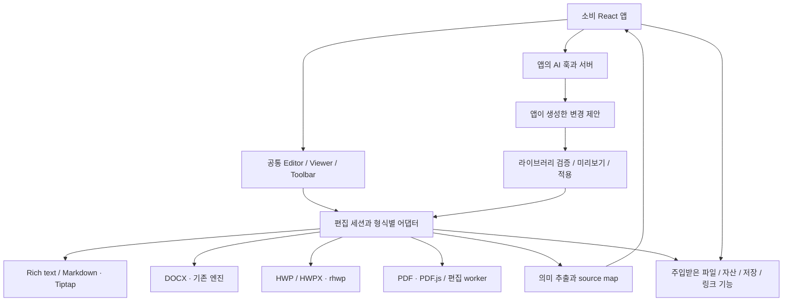
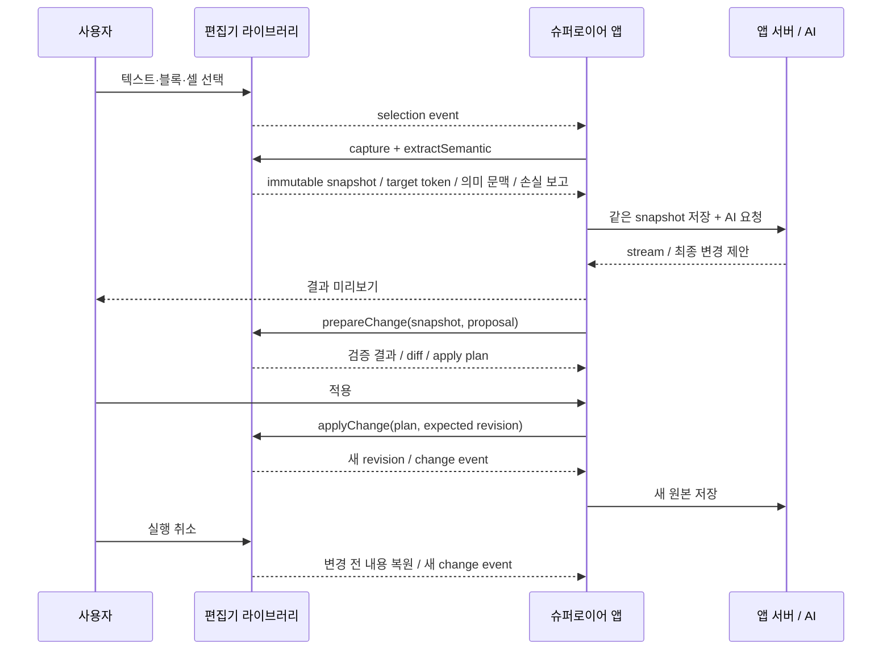

# 초기 설계 보관본 — 전사 공통 웹 편집기 라이브러리

> **이 문서는 현재 실행 계획이 아니다.** 사용자 피드백에 따라 일정·인력 추정 없이 LLM으로 단계별 개발하는 계획으로 바꾸고, LLM 품질 작업은 후속으로 이관했다. 현재 계획은 [개발 단계](./editor-architecture.md), 현재 API 범위는 [MVP 계약](./editor-contracts.md)을 따른다. 아래의 일정·JSON 원본 전환·의미 추출·모델 평가 선행 조건은 이번 출시에서 제외한다. 후속 설계 참고를 위해 보관한다.

작성: 2026-11-03 · 상태: 구현 전 RFC 보관본 · 확정 패키지명: `@lawcompany/editor`

**권고안은 이음오피스의 형식별 편집 엔진을 보존하고, 데스크톱 실행 환경과 AI 제품 기능을 제거한 React 라이브러리를 만드는 것이다. 공통화의 중심은 단일 편집 엔진이 아니라 문서 수명주기·선택·의미 데이터 추출·검증된 변경 적용 계약이다.** 첫 출시는 슈퍼로이어 롱폼에 필요한 리치 텍스트 편집기로 한정하고, DOCX·HWP/HWPX·PDF는 동일 계약을 구현하는 별도 모듈로 순차 제공한다.

가장 중요한 변경은 **저장 원본과 LLM 입력을 분리**하는 것이다. 마크다운을 JSON으로 바꾸는 것만으로 LLM 품질이 좋아진다고 가정하지 않는다. 원본 보존, 의미 추출의 정확성, 실제 모델의 업무 성능을 각각 검증한다.

이 문서는 초기 설계 제안이다. 공개 소스와 사내 FE 코드를 읽었으며, 라이브러리 추출·빌드·브라우저 호환성·모델 품질 실험은 아직 수행하지 않았다. 상세 근거는 [소스 조사](./source-audit.md), 당시 API와 데이터 구조는 [초기 계약 보관본](./editor-contracts-v1.md)에 있다.

## 1. 목표와 범위

| 구분             | 설계 기준                                                                                                                  |
| ---------------- | -------------------------------------------------------------------------------------------------------------------------- |
| 공통 사용자      | 슈퍼로이어 롱폼, 에이전트 결과 뷰어, 어드민 공지사항·콘텐츠 등 사내 React 앱                                               |
| 첫 소비처        | `sl-app-fe/apps/saas` 롱폼으로 가정. `enterprise`, `x-saas`는 같은 계약을 후속 적용                                        |
| 보존할 자산      | 이음오피스 편집 UI, 키보드 동작, 표·목록·서식, 문서 엔진, 원본 보존 저장 로직, 관련 회귀 fixture                           |
| 제거할 제품 기능 | Electron shell/main/preload, IPC transport, 데스크톱 설치·업데이트·파일 연결, 내장 AI UI·provider·agent·MCP·인증·검색·과금 |
| 라이브러리 책임  | 편집·읽기 전용 표시, 선택, 파일 변환, 의미 추출, 변경 미리보기·검증·적용·undo, 기능 지원 여부와 손실 보고                  |
| 소비 앱 책임     | AI UI·프롬프트·모델·RAG·법률 검색·스트리밍·인증·권한·과금·감사·서버 저장·업로드                                            |
| 최초 범위 밖     | 실시간 공동 편집, Excel/PPT/EPUB/마인드맵, OS 인증서·로컬 폴더 탐색, AI/OCR 제공자 실행                                    |

한글·워드·PDF·마크다운 지원은 최종 제품 범위다. 첫 롱폼 출시와 전체 포맷 동등성 완료는 별도 마일스톤으로 관리한다. 기존 UI 기능을 제외할 때는 ‘불필요한 데스크톱 기능’과 ‘아직 웹으로 옮기지 못한 편집 기능’을 구분해 기록한다.

## 2. 조사 결과가 바꾸는 설계

이음오피스 기준 커밋은 [`af65e7a0e36b7536504695d9a46449da070a578c`](https://github.com/pblsketch/openoffice/tree/af65e7a0e36b7536504695d9a46449da070a578c)다. 제품 소개만 보고 모든 편집기를 하나의 Tiptap 컴포넌트라고 가정하면 안 된다.

| 확인한 코드 구조                                                                | 설계에 미치는 영향                                                                                     |
| ------------------------------------------------------------------------------- | ------------------------------------------------------------------------------------------------------ |
| `apps/markdown`: Tiptap 3.31.0 기반 블록 편집과 Markdown 원문 보존 로직         | 롱폼의 경량 출발점. 사내 저장은 Markdown 대신 버전 있는 JSON으로 바꾸고 Markdown 파일 모드는 별도 유지 |
| `apps/docs`: Tiptap 3.31.0 화면 + `packages/docx-engine`의 OOXML 파싱·부분 저장 | 워드 엔진을 Markdown 편집기로 대체하지 않음. 원본 XML·ZIP parts와 편집 상태를 함께 보존                |
| `apps/hwp`: `@rhwp/editor`, vendored `@rhwp/core`, studio·plugin bridge         | 기존 embed 구조를 감싼 HWP 어댑터. studio/WASM 자산과 패치 재현 빌드가 필요                            |
| `apps/pdf`: PDF.js 화면, PDFium 등을 사용하는 main 쪽 편집 코드                 | 뷰어의 웹 실행 가능성과 본문 편집의 웹 이식 가능성을 별도 검증. Node 폰트·파일 접근 제거 필요          |
| `packages/ui`가 AI/provider/project-store에 의존                                | 패키지를 그대로 공용 UI로 배포하지 않음. 편집 UI만 추출하고 import graph를 분리                        |
| `docx-engine`이 `agent-core/redact-range`의 상수를 참조                         | 이름만 보고 AI 패키지를 삭제하면 저장 로직이 깨질 수 있음. 문서 기능을 순수 모듈로 이전                |
| HWP 저장 경로가 `ai/agent-bridge`를 통해 메모·탭 정보를 읽음                    | 일반 문서 명령 bridge는 보존·이름 변경, AI 호출·도구 선택 로직은 제거                                  |
| 워드·마크다운의 `aiQueueAnchors`는 문서 밖 Decoration으로 선택을 추적           | 범용 selection bookmark로 재사용할 가치가 있음. 수정 충돌 판단은 별도 보강                             |
| 마크다운 이미지 경로가 모듈 전역과 `md-asset://`에 의존                         | 인스턴스별 asset resolver로 교체해야 한 화면의 여러 편집기가 안전함                                    |

사내 롱폼에서는 아래가 확인됐다. 이는 코드로 확인한 위험 경로이며, 실제 사용자 데이터 손상이나 LLM 품질 하락을 재현했다는 뜻은 아니다.

- [저장 훅](/Users/heoyejin/DEV/sl-app-fe/apps/saas/hooks/longform/useUpdateLongformDocument.ts:47)은 HTML을 Markdown으로 변환하고 `<mark>`를 제거해 `content: string`으로 저장한다.
- [변환기](/Users/heoyejin/DEV/sl-app-fe/apps/saas/utils/editor.ts:34)는 밑줄·빈 문단·선택 하이라이트를 임시 마커로 보존하며, 역슬래시를 일괄 제거하는 단계가 있다. 포맷 경계에 의미 처리가 누적돼 있다.
- [AI 요청 경로](/Users/heoyejin/DEV/sl-app-fe/apps/saas/components/longform/LongformChat/index.tsx:150)는 저장 직렬화 결과에서 `<mark>` 위치를 찾아 `selectedBlockRange`를 만든다. 화면 선택, 저장 문자열, AI 범위가 강하게 결합돼 있다.
- [현재 extension 구성](/Users/heoyejin/DEV/sl-app-fe/apps/saas/hooks/shared/useTiptapEditor.ts:17)은 AI 출력과 사용자 서식이 저장 Markdown에서 구분되지 않는다는 사유로 취소선을 비활성화했다.
- 사내 앱은 Tiptap 2 계열, upstream은 3 계열이다. 에디터 인스턴스나 extension 객체를 두 버전 사이에 전달하지 않는다.

## 3. 아키텍처와 의존성 방향



`contracts`는 React·Tiptap·Electron·Node에 의존하지 않는다. 엔진은 공통 계약에 의존하고, React UI는 엔진을 조합한다. 어떤 라이브러리 패키지도 슈퍼로이어의 store, HTTP client, AI API를 import하지 않는다.

저장소는 `office-editor`를 이음오피스 기반의 별도 사내 fork로 운영한다. 슈퍼로이어 모노레포의 앱 코드를 복사해 제품 기능을 가져오지 않는다. 사내 registry에 버전이 고정된 패키지를 배포하고, 앱의 CI는 registry 패키지로 통합 검증한다. 로컬 공동 개발에서는 tarball 또는 workspace 연결을 이용한다.

권장 소스 구조는 다음과 같다. 각 폴더를 즉시 개별 npm 패키지로 쪼갤 필요는 없다. 처음에는 `contracts`, `editor`, 무거운 형식별 모듈을 중심으로 배포 단위를 최소화한다.

```text
office-editor/
  packages/
    editor-contracts/       # 문서/선택/변경/추출 schema, 런타임 검증
    editor/                 # 세션, React UI, rich-text/Markdown, 경량 추출
    editor-docx/            # 기존 docs 화면 + docx-engine의 웹 어댑터
    editor-hwp/             # rhwp wrapper, studio/plugin bridge, 자산 manifest
    editor-pdf/             # PDF UI와 브라우저 편집 worker
    editor-ui/              # 내부 공통 편집 UI, 테마, 번역문구
    document-utils/        # AI 패키지에 섞인 순수 문서 유틸리티
  apps/
    playground/            # 모든 기능과 2개 이상 동시 인스턴스
    integration-next/      # 사내 Next 설정에 준한 최소 소비 앱
    integration-vite/      # 어드민 SPA 통합 검증
  fixtures/                # 권한 확인된 합성·익명 문서와 golden 결과
  docs/
    upstream-map.md        # 구현 시 원본 경로/커밋 → 이동 경로/변경 이유
    capability-matrix.md   # 구현 시 형식별 실제 지원 수준
```

초기 공개 진입점 예시의 scope를 확정 이름에 맞추면 `@lawcompany/editor/react`, `@lawcompany/editor/rich-text`, `@lawcompany/editor/semantic`, `@lawcompany/editor/markdown`, `@lawcompany/editor/styles.css`, `@lawcompany/editor-docx`, `@lawcompany/editor-hwp`, `@lawcompany/editor-pdf`다. 이는 보관본의 분리 구조 제안이며, 현재 MVP는 `@lawcompany/editor` 한 패키지를 제공한다. 하위 진입점은 해당 기능만 포함해야 하며, 루트 barrel에서 모든 엔진을 재수출하지 않는다.

웹 fork의 workspace는 사내 환경에 맞춰 pnpm으로 관리하고, 브라우저 패키지는 Vite library build의 ESM과 TypeScript declaration을 배포하는 안을 기본으로 한다. React/ReactDOM을 external로 두고 client entry의 `'use client'`를 출력에도 보존한다. `exports`와 `files`로 공개 파일을 제한하며 CSS는 `sideEffects`에 포함한다. Worker·WASM·studio는 일반 JS 번들과 별도 빌드/manifest로 관리한다. 타입 검사→단위/fixture→패키지 빌드→tarball 소비 앱의 production runtime→license/contents 검사 순서로 release를 검증한다. 처음부터 CJS 호환을 약속하지 않고 실제 사내 ESM 소비 환경을 기준으로 검증한다.

## 4. Electron·AI 제거 작업표

| 기존 책임                                      | 웹 전환 방식                                                               | 소유자     |
| ---------------------------------------------- | -------------------------------------------------------------------------- | ---------- |
| `BrowserWindow`, shell tabs, OS menu           | React mount/unmount, 앱 라우팅·탭에 위임                                   | 앱         |
| preload와 `window.*Api`                        | 타입이 있는 인스턴스별 port 주입. 과도기 shim은 개발용으로만 사용          | 라이브러리 |
| 로컬 열기·저장·복구 파일                       | `File`/`Blob`/`Uint8Array` 입출력, 앱 저장 콜백, 브라우저 다운로드         | 공동       |
| `file://`, `md-asset://`, 로컬 폰트            | `assetId`와 resolver, 패키지 자산 URL, 제공된 font bytes                   | 공동       |
| main의 순수 parse/save/edit 함수               | DOM 없는 모듈 또는 Web Worker로 이전, Node 의존은 실제 웹 구현으로 교체    | 라이브러리 |
| printToPDF, OS 인쇄                            | 인쇄용 화면 + 브라우저 인쇄. 정밀 PDF 생성은 별도 export capability        | 라이브러리 |
| AI 패널·모델 선택·API key·OAuth·agent loop·MCP | 배포 대상에서 제거                                                         | —          |
| 문서 선택·치환·표 조작·메모·redaction 유틸리티 | 일반 편집 command와 문서 유틸리티로 추출                                   | 라이브러리 |
| AI diff·대기 중 선택 표시                      | 범용 외부 변경 미리보기·bookmark로 일반화                                  | 라이브러리 |
| AI 검색·번역·OCR·프롬프트·스트리밍             | 소비 앱이 실행하고 결과만 문서 API로 전달                                  | 앱         |
| 자동 저장                                      | change event와 checkpoint 제공, debounce·재시도·동시 저장 정책은 앱이 결정 | 공동       |

`src/main` 전체를 삭제하기 전에 그 안의 편집 알고리즘을 이동한다. 반대로 `agent-core`를 남겨 놓고 AI 버튼만 숨기는 것은 완료로 보지 않는다. 배포 tarball·의존 그래프·실행 시 네트워크를 함께 검사해 AI runtime, provider SDK, Electron, 로컬 경로 접근이 남지 않았는지 확인한다.

### 웹 실행 세부 원칙

- 기본 환경은 브라우저이며 서버 변환 서비스는 필수 의존으로 두지 않는다. 브라우저 이식이 안 된 기능은 `unsupported`로 표시한다. 추후 변환 서버가 필요하면 앱이 별도 port로 연결한다.
- Worker/WASM/studio는 버전이 같은 자산 manifest로 배포한다. 앱에서 `assetBaseUrl`을 설정하고 외부 CDN 자동 fallback은 두지 않는다. Next standalone 배포에도 자산을 포함한다.
- HWP의 기존 frame 경계는 유지할 수 있다. 전체 라이브러리를 iframe 앱으로 만드는 것은 아니다. frame 통신은 origin/source·instanceId·requestId·메시지 schema를 검증한다.
- import 시 `window`, `document`, `localStorage`, Worker를 실행하지 않는다. React 진입점은 client boundary를 표시하고 실제 mount 후 초기화한다. 문서 접근은 세션 단위로 격리한다.
- React/ReactDOM은 peer dependency, 지원 출발점은 실제 소비 앱의 React 19다. 검증 없이 React 18까지 지원한다고 표시하지 않는다.
- Tiptap/ProseMirror는 라이브러리 내부의 호환 버전 집합으로 관리한다. 소비 앱의 v2 extension을 public API로 받지 않는다. v2/v3 동시 로드 시 번들 비용은 감수하되 객체와 plugin key 경계를 섞지 않는다.
- CSS는 에디터 루트와 portal container에 범위를 제한한다. 전역 reset과 `body` 타이포그래피를 적용하지 않는다. 테마는 CSS variables, 문구는 앱이 제공한 번역 문자열로 받는다.
- 한글 IME 조합 중 snapshot/명령 실행은 조합 완료까지 지연하거나 명시적으로 재시도하게 한다. 조합 중 문서 전체 `setContent`는 금지한다.
- `destroy()`는 listener, timer, Worker, frame, object URL, bookmark를 해제한다. React StrictMode 재마운트와 동시 편집기 2개를 기본 검증한다.

## 5. 문서 원본: 하나의 저장 형식으로 강제하지 않는다

공통 `DocumentEnvelope`는 문서 ID, 형식, schema version, 엔진 payload version, 저장 revision, asset reference를 표현한다. 문서 내용의 권위 있는 원본은 형식마다 다르다.

| 문서 종류                  | 권위 있는 저장 데이터                                                 | 주의점                                                                                       |
| -------------------------- | --------------------------------------------------------------------- | -------------------------------------------------------------------------------------------- |
| 신규 롱폼·어드민 rich text | 등록된 schema를 따르는 Tiptap JSON + stable IDs + asset manifest      | HTML/Markdown은 파생본. 모르는 node/attribute를 조용히 제거하지 않음                         |
| 외부 `.md` 문서            | Markdown 원문 + frontmatter·개행 정보 + 기존 round-trip snapshot      | rich-text JSON을 매번 `.md`로 바꿔 원문을 덮지 않음. 표현 불가능한 서식은 export 손실로 보고 |
| DOCX                       | 원본 DOCX bytes + 엔진 편집 모델/지원된 patch → 저장 시 새 DOCX bytes | `originalXml`, parts, relationships 등 보존. Tiptap JSON만 저장하면 충분하지 않음            |
| HWP/HWPX                   | rhwp가 export한 해당 형식 bytes + 필요 시 앱 sidecar metadata         | HWP와 HWPX 간 무손실 변환을 가정하지 않음                                                    |
| PDF                        | 원본 bytes와 편집 상태 → 지원 명령을 반영한 PDF bytes                 | 화면 annotation layer만 저장하고 완료로 처리하지 않음. 본문 수정·주석·폼을 구별              |

DOCX/HWP/PDF를 rich text로 가져오기는 ‘변환하여 새 문서 만들기’다. 원래 포맷에서 편집하기와 다르게 표시하고 변환 손실 보고서를 반환한다. 원본은 유지한다.

바이너리 문서는 매 키 입력마다 전체 export하지 않는다. 편집 세션 안에서는 엔진 모델과 revision을 유지하고 저장 checkpoint에서 bytes를 만든다. durable 저장은 앱의 blob 저장과 문서 metadata 갱신을 원자적 버전으로 묶는다. 업로드 완료 전 저장 성공을 알리지 않으며 실패하면 기존 revision과 dirty 상태를 유지한다.

새 rich-text schema는 upstream Markdown의 제약을 그대로 따르지 않는다. 첫 롱폼에서 제목, 문단, ordered/bullet list, 표, 링크, bold/italic/underline, 명시적 hard break, inline reference를 지원하고, 필요한 기존 `Ins`/`Del` 의미를 이관한다. 취소선, 사용자 highlight, 변경 추적, 선택 Decoration은 서로 다른 개념으로 모델링한다. 기능을 숨기는 UI preset과 저장 schema를 분리해 간소화된 뷰어가 서식을 삭제하지 않게 한다.

## 6. LLM을 위한 의미 데이터 계약

전달 경로는 **엔진 모델 → 버전 있는 의미 projection → 앱이 선택한 AI 요청 형식**이다. 화면 DOM·HTML CSS·Markdown serializer를 의미 추출의 공통 중간 형식으로 삼지 않는다.

```text
권위 있는 원본 ──→ 편집 / 원래 형식으로 저장
       │
       └──→ SemanticDocument + source map + loss report
                     │
                     └──→ 앱의 개인정보 정책 / context 선택 / 직렬화
                                  └──→ 앱의 LLM 서버
```

라이브러리는 AI를 호출하지 않는 `extractSemantic()`을 제공한다. AI 외에 검색·접근성·문서 비교에도 사용할 수 있는 일반 문서 기능이다. `SemanticDocument`는 저장 원본의 대체물이 아니다.

### 보존할 의미와 제외할 표시 정보

| 요소                           | 의미 projection 규칙                                                                                              |
| ------------------------------ | ----------------------------------------------------------------------------------------------------------------- |
| 문단·제목                      | 문서 순서, stable block ID, 제목 단계, 정확한 텍스트와 hard break                                                 |
| 목록·법률 조항                 | 계층, 시작 번호, 명시 label, 번호 재시작을 보존. 자동 번호를 본문 문자와 혼동하지 않음                            |
| 표                             | 행/셀 ID, 행·열 좌표, `rowSpan`/`colSpan`, header 역할, 셀 안의 블록을 보존. 병합 셀 내용을 여러 번 복제하지 않음 |
| 각주·미주·인용                 | 본문 참조와 대상 ID, 각주 본문, 출처 객체의 연결을 보존. 문장 뒤에 무작정 이어 붙이지 않음                        |
| 링크                           | label과 허용된 target을 구분. 일회성 다운로드 URL·인증 query string은 AI projection에서 제거                      |
| 수식·코드                      | 공식 source/언어/그대로의 텍스트, 해석 불가 시 opaque와 사유                                                      |
| 이미지·차트                    | asset ID, 작성된 alt/caption, 위치. OCR/설명은 앱이 제공한 별도 provenance 필드로만 포함                          |
| bold·underline·strike 등       | 의미가 있을 수 있는 mark를 보존. 제거는 앱의 명시적 profile에서만 결정                                            |
| 색상·폰트·크기·여백            | 기본 projection에서 생략 가능하나 생략 항목을 기록. 색상으로 상태를 구분하는 문서는 앱 profile로 포함             |
| 변경 추적                      | 확정 내용/수정 제안/삭제 이력을 구별. `current`, `original`, `withChanges`를 명시하여 추출                        |
| 주석·숨김 텍스트·머리말·꼬리말 | 기본 포함 여부를 profile로 명시. 기본값은 주석·숨김 제외, 본문이 참조한 각주 포함. 제외 범위를 보고               |
| 선택색·커서·AI 미리보기        | 문서 모델에 넣지 않고 projection·저장 모두에서 제외                                                               |
| 지원하지 못하는 내용           | `unsupported` node 또는 loss entry로 위치·사유·영향을 반환. 빈 문자열로 은폐하지 않음                             |

‘깨끗하다’는 ‘서식이 전혀 없다’는 뜻이 아니다. “제3항”, 표의 열 제목, 삭제된 문장 여부가 사라지면 문장은 읽기 쉬워도 의미는 틀릴 수 있다. 반대로 모든 OOXML 속성을 모델에 보내면 불필요한 정보가 커진다. 재현 가능한 규칙과 생략 보고가 필요하다.

`ExtractionReport`는 `complete | partial | failed`, 읽지 못한 영역, 의도적 제외, 추정한 읽기 순서, truncation을 담는다. 부분 추출의 정보는 UI와 서버 요청 양쪽에 전달한다. 선택 대상에 읽지 못한 의미 요소가 있으면 MVP의 자동 변경 제안 생성 경로는 중단하고 앱이 사용자에게 범위를 조정하게 한다.

PDF의 읽기 순서·표 구조와 스캔 PDF의 본문은 특히 불확실하다. PDF 텍스트 좌표를 그대로 문단 구조로 단정하지 않는다. 검증된 구조/추정 구조/앱 OCR 결과를 구별하고, 숫자 confidence가 없는 엔진에 임의의 점수를 만들지 않는다. OCR이 없으면 텍스트 없는 페이지가 있다는 사실을 반환한다.

### 선택 영역과 문맥

선택은 문자열 하나가 아니라 `text-range | blocks | cells | document`다. 일부 셀을 선택했으면 **수정 가능한 선택 범위**와 **참고용 행·열 제목**을 구분해서 제공한다. 관련 제목·상위 목록·참조 각주를 문맥에 포함할 수 있지만 그 문맥은 자동 수정 대상이 아니다.

`blockId`는 배열 index나 텍스트 hash로 만들지 않는다. 새 노드 생성 시 발급하고 이동·일반 편집·undo에서 유지하며, split/merge/copy-paste에는 ID 규칙을 둔다. DOCX/HWP/PDF에서 영구 ID가 지원되지 않는 영역은 문서 revision에 종속된 source anchor로 표현한다. 모든 포맷에서 동일한 영구 ID가 존재한다고 약속하지 않는다.

공개 텍스트 offset은 추출된 정확한 문자열의 UTF-16 code unit 기준, `[start, end)`로 정의한다. ProseMirror 위치·HWP char index·PDF 좌표와 동일하지 않다. 엔진 어댑터가 source map을 제공하고 원본과 projection 사이에 명시적으로 변환한다. 한글 조합형/완성형, emoji, 결합문자에 대해 JS와 서버 언어의 인덱스 차이를 테스트한다. 비교용 정규화 문자열을 적용 좌표로 재사용하지 않는다.

### AI 팀과 합의할 내용

초기부터 구조·revision·선택·손실 보고의 최소 계약을 함께 검토한다. 에디터 MVP가 준비된 뒤에는 실제 모델을 이용해 최종 LLM 직렬화 방식을 결정한다. UI 개발이 끝난 뒤에야 서버 계약 변경 필요성을 발견하지 않도록 한다.

비교 후보는 ① 기존 Markdown, ② 의미 JSON 직접 입력, ③ semantic JSON을 태그 있는 텍스트로 표현하고 표·각주 metadata를 곁들이는 방식이다. 라이브러리는 ②를 표준 교환 모델로 제공하지만, 서버가 LLM에 ②를 그대로 보낼 필요는 없다. 토큰 예산, context 절단, chunking, 모델별 prompt는 AI 팀 책임이며, 절단한 블록과 범위는 기록한다.

동일한 합성·익명 문서와 작업으로 표 숫자 정확성, 조항·각주 인용 연결, 선택 밖 수정, 답변의 사실 보존, 토큰·지연을 비교한다. 구조 추출의 결정적 테스트와 비결정적인 모델 평가를 분리하고, 평가에 사용한 원본 revision·projection/profile 버전·모델 설정을 남긴다.

## 7. 첫 소비처: 블록 선택 → AI 질의 → 결과 반영

라이브러리에는 `askAI()`나 provider 설정을 만들지 않는다. 앱은 선택 UI slot에 ‘AI에게 요청’ 버튼을 넣고, 일반 문서 API를 호출한다.



1. **요청 시점 고정.** selection callback은 UI 갱신용이다. 실제 제출 시 `capture()`가 동일 시점의 문서·선택·local revision을 원자적으로 잡는다. 비동기 추출 중 사용자가 편집하더라도 이 snapshot의 내용만 읽는다. 포커스 이동으로 선택을 잃지 않도록 bookmark를 먼저 만든다.
2. **저장과 AI 입력 일치.** 앱은 같은 snapshot을 저장하고 서버가 반환한 immutable content version에 요청을 연결한다. 저장을 생략한 경우에도 기존 서버 version과 내용 일치를 확인한다. 서버가 ‘현재 최신 문서’를 다시 조회해 다른 버전을 읽게 하지 않는다.
3. **스트리밍은 앱의 preview.** 미완성 HTML/Markdown/JSON을 매 토큰마다 원문에 적용하지 않는다. 취소·실패 시 원문은 그대로다. `requestId`와 문서 ID로 늦은 응답·중복 응답을 구분한다.
4. **결과 구조 검증.** 앱은 AI 출력을 제한된 fragment 또는 변경 제안으로 변환한다. 라이브러리는 schema, 크기, 허용 command, target 범위, 참조 무결성을 다시 검증한다. JSON parse 성공만으로 유효하다고 보지 않는다.
5. **적용 직전 충돌 검사.** MVP는 요청 이후 문서 revision이 바뀌면 `conflict`를 반환한다. 현재 cursor나 비슷한 문장에 임의 치환하지 않는다. 사용자는 재요청하거나 새 기준에서 다시 검토한다.
6. **원자적 적용과 되돌리기.** 제안 한 건은 하나의 undo 단위로 적용한다. 여러 연산 중 하나라도 실패하면 전체 적용을 취소한다. 성공 후 입력한 사용자 편집은 별도 undo 단위여야 한다. 저장된 버전 복구는 앱 기능으로 별도 유지한다.

후속 개선에서만 target 밖의 변경을 rebase한다. 원본 bookmark를 transaction mapping으로 이동시키고, 대상의 텍스트·구조·서식·참조 fingerprint와 문서 identity를 재검증한다. **위치가 이동됐다는 사실은 대상 내용이 그대로라는 보장이 아니다.** 표 구조 변경, target 삭제, 문서 재로드, mapping 소실, 대상 안 변경은 conflict로 남긴다. 불완전한 매핑을 지원하는 HWP/PDF에서는 strict revision 검사를 유지한다.

편집기 세션의 local revision과 서버 content version은 구분한다. local revision은 undo로 이전 내용이 돌아와도 과거 값으로 돌아가지 않는다. `applyChange`는 준비된 plan의 revision과 현재 revision을 compare-and-swap 방식으로 확인한다. 이미 소비한 plan ID를 다시 적용할 수 없다.

서식 보존은 ‘AI 문장이 바뀌어도 모든 글자 서식을 자동 복원’으로 약속하지 않는다. 기본은 문단·셀의 구조/서식을 유지하고 선택 내부 inline marks를 명시적 정책에 따라 교체하는 것이다. 대응 관계를 알 수 없는 혼합 서식은 미리보기에 손실을 표시한다. 인용·각주·필드는 단순 텍스트 치환으로 삭제하거나 고아 참조를 만들지 못하게 보호한다. MVP에서 안전하게 바꿀 수 없는 선택은 적용을 막는다.

## 8. 공통 UI와 capability

하나의 `Editor` facade를 제공하되 지원되지 않는 기능을 모든 포맷에 억지로 맞추지 않는다. `capabilities`는 `supported | limited | unsupported`와 사유를 반환하고, 파일 상태·잠금·암호·엔진 상태에 따라 바뀔 수 있다. Viewer 전용 앱은 편집·AI 패키지를 자동 로드하지 않는다.

| 프로필     | 사용처         | UI 구성                                                                   |
| ---------- | -------------- | ------------------------------------------------------------------------- |
| `longform` | 슈퍼로이어     | 문서 본문, 필요한 서식 도구, selection action slot, 외부 proposal preview |
| `viewer`   | 에이전트 결과  | 같은 문서 모델의 읽기 전용 렌더링, 복사·내보내기, 편집 전환               |
| `content`  | 어드민         | 간소화 툴바, 링크·표·이미지, 앱 validation과 폼 연결                      |
| `office`   | 원본 문서 편집 | upstream ribbon/페이지/주석 등을 가능한 한 유지                           |

프리셋은 toolbar visibility와 기본 설정이다. 공지사항 앱이 툴바를 줄였다는 이유로 문서 로드 시 고급 node를 삭제하면 안 된다. profile이 생성 가능한 node와 읽기/보존 가능한 node를 구분한다.

| 기능                  | 롱폼 MVP                         | DOCX 후속                | HWP/HWPX 후속                      | PDF 후속                                   |
| --------------------- | -------------------------------- | ------------------------ | ---------------------------------- | ------------------------------------------ |
| 보기·선택·일반 편집   | 필수                             | 기존 화면 이식           | 기존 studio 이식                   | 보기/주석 우선, 본문 편집 별도 gate        |
| 구조 있는 의미 추출   | 문단·목록·표·기존 reference 필수 | 각주·번호·필드 포함 검증 | 문단·표·각주 bridge 검증           | 페이지/좌표 기본, 읽기 순서·표는 제한 명시 |
| 범위 교체·atomic undo | 필수                             | adapter 검증 후 제공     | 엔진 transaction 지원 검증 후 제공 | 지원 가능한 연산만 제공                    |
| 원래 형식 저장        | JSON/Markdown 분리               | OOXML 부분 저장 보존     | 해당 bytes export 검증             | 주석·폼·본문별 실제 저장 검증              |
| DOCX/PDF 내보내기     | 독립 format 모듈 준비 후 활성화  | renderer/폰트/인쇄 검증  | 기존 print flow 웹 대체 검증       | PDF 원본 저장과 별도 구분                  |

이 표는 구현 목표이며 현재 기능을 검증했다는 표가 아니다. HWP/PDF가 atomic undo를 제공하지 못하면 checkpoint 기반 복구를 구현하거나 해당 변경 capability를 제한한다. 원자성을 흉내 내는 부분 적용은 허용하지 않는다.

## 9. 슈퍼로이어 마이그레이션

### 서버 계약의 선행 변경

현재 FE의 `TLongformDocument.content: string`, `refDocumentId`, `selectedBlockRange`를 단순히 JSON 문자열로 바꾸지 않는다. 서버 구현은 이번 조사 범위에 없으며 아래는 BE·AI 팀과 합의할 변경안이다.

- 문서 저장에 `contentFormat`, `schemaVersion`, `enginePayloadVersion`, canonical payload/reference, 서버 content version을 추가한다. 필요하면 기존 경로와 구분된 v2 API를 둔다.
- AI 요청은 `requestId`, `documentId`, `baseContentVersion`, projection version/profile, immutable semantic snapshot, target token을 연결한다. 서버는 권한과 버전 일치를 검사한다.
- 저장 충돌은 `expectedContentVersion`으로 감지한다. 여러 탭 또는 자동 저장의 응답 순서가 바뀌어도 오래된 저장이 최신 문서를 덮지 않는다.
- Markdown `content`는 기존 소비자를 위한 파생 필드로 유지할 수 있지만 새 canonical의 권위를 갖지 않는다. 새 JSON과 legacy 문자열을 서로 독립적인 원본으로 dual-write하지 않는다.
- 새 schema 문서를 모르는 클라이언트가 저장할 경우 서버가 거절한다. 프론트 feature flag만으로 구버전 writer를 막을 수 없다.

### 적용 순서

| 단계                   | 작업                                                                | 종료 조건                                                |
| ---------------------- | ------------------------------------------------------------------- | -------------------------------------------------------- |
| 1. 테스트 소비 앱      | library tarball로 Next/Vite에서 mount·편집·export, fake port로 동작 | Electron·AI 서버 없이 사용 가능                          |
| 2. 신규 문서 pilot     | feature flag로 JSON 원본 문서만 새 에디터에서 생성                  | 재로드·저장·블록 요청·적용·undo 정상                     |
| 3. 기존 문서 읽기      | legacy Markdown을 1회 import, 원문 hash·변환기 버전·손실 기록 보존  | 같은 입력의 변환이 재현 가능, 실패 문서는 기존 경로 유지 |
| 4. 사용자 편집 시 승격 | 새 canonical version 저장, 원래 Markdown/version은 별도 보관        | 서버가 구버전 writer 차단, 선택 좌표 체계 전환           |
| 5. 범위 확장           | 기업/글로벌 롱폼, 결과 viewer, 어드민 순으로 preset 적용            | 앱별 UX·schema·저장·성능 검증                            |

과거 Markdown에 이미 사라진 서식을 복구할 수 있다고 약속하지 않는다. raw Markdown의 `<u>`, `<br>`, `Ins`/`Del`, 기존 reference 표현은 fixture로 확인하고, 과거 AI diff용 표기를 문서의 확정 내용과 구분해 이관한다.

마이그레이션 뒤에도 Markdown에만 의존하는 AI 서버를 잠깐 사용할 수는 있다. 이 경우 앱의 legacy adapter가 한 snapshot에서 문자열과 정확한 range map을 함께 생성하고, 미지원 구조가 있는 요청은 막는다. 이것은 한시적 호환이며 ‘깨끗한 LLM 전달’ 완료로 보지 않는다. UTF-16 기준에 맞지 않는 기존 서버 offset 계약은 BE와 실제 동작을 확인한 뒤 변환한다.

새 원본을 만든 뒤 feature flag를 끄더라도 손실 있는 Markdown으로 되돌려 덮어쓰지 않는다. 새 schema를 읽을 수 있는 이전 라이브러리 버전으로 rollback하거나 새 형식 문서를 읽기 전용으로 제공한다. 기존 legacy 문서는 기존 에디터를 계속 사용할 수 있다.

### 사내 코드의 교체 경계

| 현재 코드                                           | 변경 방향                                                                         |
| --------------------------------------------------- | --------------------------------------------------------------------------------- |
| `hooks/shared/useTiptapEditor.ts`                   | 라이브러리 세션/React 훅으로 대체. 앱에 upstream extension 목록 노출 금지         |
| `hooks/longform/useEditorSelectionHandler.ts`       | 일반 selection event와 bookmark 사용. `<mark>`를 원본에 넣는 방식 제거            |
| `utils/editor.ts`                                   | 기존 Markdown import용으로 범위 축소. 신규 저장·AI 범위 계산에서 제거             |
| `useUpdateLongformDocument`, `useLoadEditorContent` | canonical checkpoint와 서버 version 사용. 내용 없는 저장·중복 버전 방지 정책 보존 |
| `LongformChat`의 요청 준비                          | `useLongformEditorContext` 등 앱 훅으로 이동, snapshot/저장/AI 요청 연결          |
| `useCreateMessage`, 인증·요금·분석·서버 API         | 앱 소유 유지. 문서 계약만 변경                                                    |
| stream/diff 표시                                    | 앱에서 결과 수신, 라이브러리에서 검증된 preview/apply/undo                        |

사내 규칙대로 업무 로직은 hooks에, API 호출은 `lib/http.ts`의 `request()` 계층에 둔다. 라이브러리를 루트 layout/공용 barrel에서 무겁게 정적 import하지 않는다. 롱폼 client boundary에서 필요한 엔진만 로드한다. 이번 설계 작업에서는 `sl-app-fe` 파일을 변경하지 않았다.

## 10. 검증 기준

처음부터 세 가지 gate를 분리한다. **원본 보존, 의미 추출, AI 업무 품질 중 하나의 통과가 다른 것의 통과를 대신하지 않는다.**

| 검증 영역   | 필수 시나리오와 판정                                                                                                                                                 |
| ----------- | -------------------------------------------------------------------------------------------------------------------------------------------------------------------- |
| 의존성 분리 | tarball 설치 후 Electron·Node builtin·AI provider runtime을 요구하지 않음. 명시한 자산/앱 port 외 네트워크 호출 0                                                    |
| schema      | 저장→로드 후 지원 요소의 의미·서식 동일, ID 중복 없음, unknown schema 차단. 기존 문서 migration fixture                                                              |
| 원본 보존   | Markdown/DOCX의 upstream 무편집 보존 조건 유지. DOCX는 수정 밖 parts/XML 보존 검사. HWP/PDF는 지원 포맷의 재열기·의미·화면 검사이며 무조건 byte 동일을 주장하지 않음 |
| 포맷 호환   | DOCX는 Word, HWP/HWPX는 한컴, PDF는 독립 viewer로 표·폰트·페이지·주석 확인. 포맷 변환은 별도 loss 검사                                                               |
| 의미 추출   | 제목/목록 번호/병합 표/각주/인용/수식/참조 graph가 golden과 일치. 생략·미지원·읽기 순서 추정을 보고                                                                  |
| 선택        | 문자 일부, 다중 블록, 표 셀, 첫 문자, 마지막 문자, 빈 선택, 한글 IME, emoji, 중복 문장                                                                               |
| 변경 적용   | 요청 중 편집/문서 이동/재로드/target 삭제/응답 역전/취소/중복 적용. 범위 밖 변경 0, 실패 시 부분 적용 0, 한 번의 undo로 정확 복원                                    |
| 제품 UX     | 키보드 선택·붙여넣기·Tab, 접근성 이름/포커스, 스크린리더의 본문 접근. 캔버스 엔진의 접근성 한계는 별도 기록                                                          |
| 통합        | Next dev와 production build/runtime, Vite production, CSS/portal 격리, StrictMode, 두 인스턴스, 자산 경로, Worker/CSP                                                |
| 입력 방어   | HTML/URL sanitize, 불법 schema/과도한 중첩/큰 이미지/ZIP 폭탄 제한, 문서 embedded script·외부 resource 자동 실행 차단                                                |

회귀 corpus는 법률 문서를 닮은 합성 fixture부터 만든다. 장문 조항, 중첩 목록, 병합·중첩 표, 여러 각주, 한글/영문/emoji, 이미지 caption, 악성 HTML, 암호 문서, 스캔 PDF, unknown node를 포함한다. 실제 사내 문서는 권한·익명화를 거친 fixture만 사용한다.

성능 수치는 아직 측정값이 없다. 1단계에서 지원 기기·브라우저와 corpus를 고정하고 예산을 확정한다. 출발 목표는 일반 롱폼 약 5만 자/500블록에서 입력 지연 p95 50ms 이내, 선택 snapshot+추출 200ms 이내, rich-text 초기 전송 JS gzip 500KB 이내다. 50만 자/대형 표는 스트레스 케이스로 별도 측정한다. HWP/PDF의 WASM·폰트는 이 예산에 숨기지 않고 크기·cold start·메모리를 별도로 공개한다. 측정 후 목표 변경은 이유와 함께 기록한다.

Chromium·Firefox·Safari 현행 지원 대상에서 rich text를 확인하고, HWP/PDF는 엔진별 검증이 끝난 조합만 지원 표에 올린다. 모바일은 최소 viewer와 복사 동작부터 검증하며, office 수준 편집 지원은 별도 gate다.

앱 로그에는 기본적으로 원문·prompt·선택 텍스트를 남기지 않는다. 에러 코드, 문서 형식, schema/projection 버전, 익명 집계 성능, loss code 정도를 앱 callback으로 전달한다. 에디터 내부 텔레메트리 SDK는 넣지 않는다.

## 11. 개발 순서와 완료 조건

기간은 **전담 FE 2명, QA 약 0.5명, BE·AI 담당자의 계약/평가 참여**를 가정한 초기 추정이다. 라이브러리 설계와 정적 조사만으로 일정 확정은 불가능하며, 첫 spike 결과로 재산정한다.

| 단계                 | 산출물                                                                                                                                     | 초기 추정       | 완료 gate                                                                       |
| -------------------- | ------------------------------------------------------------------------------------------------------------------------------------------ | --------------- | ------------------------------------------------------------------------------- |
| P0. 추출 가능성 확인 | fork 기준 고정, import graph, rich-text 브라우저 vertical slice, DOCX worker parse/save, HWP studio 로드/export, PDF 보기와 단일 편집 실험 | 1–2주           | 포맷별 이식 장애와 필수 기능 누락이 수치/재현으로 드러남. 진행/범위 재조정 결정 |
| P1. 롱폼 MVP         | JSON 원본, 의미 projection, 선택 snapshot, 제안 검증·preview·apply·undo, React API, registry alpha, 앱/BE v2 계약                          | 추가 4–6주      | 신규 문서 롱폼 전체 흐름, 데이터 보존·충돌 gate, AI 팀 1차 평가 통과            |
| P2. 공통 적용 안정화 | legacy migration, 기존 저장/버전 UX 보존, viewer/content preset, 운영 rollout·rollback                                                     | 추가 2–3주      | 파일럿 회귀 0, 지원 브라우저와 사내 production 소비 검증                        |
| P3. Word·한글 이식   | 기존 편집 UI와 원본 저장 유지, 각 어댑터, 자산 배포, 포맷 corpus                                                                           | 추가 4–8주 이상 | 각 포맷의 독립 capability gate. 동시에 완성돼야 출시하는 방식은 피함            |
| P4. PDF 편집 확장    | 본문 편집 worker, 폰트 resolver, 주석·폼 저장, 의미 추출 제한 문서화                                                                       | 추가 4–8주 이상 | 실제 저장 재열기, 원본/선택 일치, 지원하지 못한 기능 명시                       |

P1까지 약 5–8주가 첫 가설이다. P3/P4는 P0의 native/Node 의존 조사에 가장 민감하며 전체 포맷 동등성을 MVP 일정에 포함하지 않는다. 기존 엔진을 활용하더라도 렌더러 분리, 의미 추출, 안정적 위치 계약, 저장 검증은 새 작업이다.

구현 이슈의 첫 묶음은 다음 순서로 만든다.

1. upstream pin·라이선스·배포 포함 목록·기능 inventory 작성.
2. Markdown renderer의 편집 core와 순수 UI를 추출하고 가짜 file/asset port로 브라우저 실행.
3. AI 영역의 일반 문서 명령·상수·bookmark를 이동하고 의존 그래프에서 AI/Electron을 제거.
4. 세션·문서 envelope·schema·capability·asset resolver와 React lifecycle 구현.
5. rich-text canonical 저장, 의미 projection, loss report, selection snapshot/source map 구현.
6. 제한된 change proposal·revision 검사·원자적 적용·undo 구현.
7. BE v2 계약과 롱폼 앱 훅 연동, legacy corpus 및 AI 평가, feature flag pilot.
8. DOCX/HWP/PDF 어댑터를 각 검증 gate에 맞춰 확장.

에디터 담당 팀은 schema·selection·change·포맷 엔진의 owner다. 앱 FE는 UI 연결·업무 훅·저장 상태의 owner, BE는 권한·version CAS·migration의 owner, AI 팀은 prompt·context·모델 출력 해석·평가의 owner다. 계약 변경은 관련 owner의 호환성 검토를 거친다.

## 12. 배포·유지보수·라이선스

fork는 upstream remote와 기준 커밋을 유지한다. 원본 경로의 이동과 수정 이유를 추적하고, upstream 변경은 영향 있는 엔진/수정만 검토해 가져온다. 불필요한 전체 코드 스타일 정리는 upstream diff를 키우므로 초기에는 하지 않는다. 새 public 계약은 사내 규칙에 맞는 TypeScript `type`과 런타임 schema를 제공한다.

패키지 버전과 저장 schema version, projection version, 엔진 payload version은 따로 관리한다. 앱은 exact package version을 사용하고 지원 schema 범위를 선언한다. 오래된 문서 읽기와 순방향 migration fixture를 CI에 유지한다. downgrade를 지원하지 못하는 문서는 쓰기를 거절한다. 보안 수정은 주기적으로 확인하고 upstream 수용 시 원본 보존 corpus를 다시 실행한다.

공개 API/동작의 비호환 변경은 SemVer major, 기존 계약을 유지하는 선택적 기능 추가는 minor로 배포한다. 저장 형식 변경은 패키지 버전만으로 감지하지 않고 schema migration과 reader/writer 호환표를 함께 제공한다. alpha 단계에서도 운영에 저장한 문서를 버리는 방식으로 schema를 바꾸지 않는다.

Apache-2.0 배포 조건에 맞춰 LICENSE, 적용되는 NOTICE/저작권 고지, 변경 파일의 수정 고지를 유지한다. 브라우저로 전달되는 패키지·WASM·폰트·studio도 배포 포함물로 inventory에 넣는다. rhwp와 포함 폰트·PDF 엔진 등의 라이선스를 개별 확인하고 재배포용 third-party notices를 생성한다. 이음오피스/GenOffice의 이름·로고 사용 권한은 코드 라이선스와 별개이므로 사내 라이브러리 명칭·브랜딩으로 바꾼다. [Apache-2.0 본문](https://www.apache.org/licenses/LICENSE-2.0), [upstream NOTICE](https://github.com/pblsketch/openoffice/blob/af65e7a0e36b7536504695d9a46449da070a578c/NOTICE).

포크의 편집 기능을 유지하려면 upstream 회귀 테스트와 합법적으로 재배포 가능한 fixture도 함께 이관해야 한다. tarball 안에 불필요한 AI prompt·provider 설정·내부 문서·데스크톱 실행물이 섞이지 않는지 release gate에서 검사한다.

## 13. 확정할 수 있는 것과 후속 결정

지금 설계 기준으로 정할 수 있는 것은 **AI의 앱 소유, 형식별 원본 보존, 의미 projection 분리, revision에 연결된 선택·변경 계약, 라이브러리의 명시적 IO, 롱폼부터 시작하는 단계적 배포**다.

다음 항목은 책임자를 정해 확인한다. 확인 전에는 구현됐거나 지원된 것으로 표시하지 않는다.

| 결정 항목                                                                                        | 결정 시점/담당                                |
| ------------------------------------------------------------------------------------------------ | --------------------------------------------- |
| 첫 앱이 `saas`인지, 필요한 롱폼 서식·reference 목록                                              | P0 시작, 제품·앱 FE                           |
| 실제 BE의 version/offset 계약, JSON 원본 저장 및 API rollout                                     | P0–P1, BE·앱 FE                               |
| 의미 projection의 기본 포함 범위와 최종 prompt 직렬화                                            | 최소 계약은 P0, 실제 모델 비교는 MVP 후 AI 팀 |
| DOCX parser dependency 전체의 브라우저 실행, HWP 빌드 패치·frame 제약, PDF 편집의 Node 대체 비용 | P0, 라이브러리 FE                             |
| 포맷별 atomic transaction/undo·영구 anchor 지원 한계                                             | P0 및 각 포맷 출시 전, 라이브러리 FE          |
| private registry, 브라우저 지원·정밀 PDF export·모바일 범위                                      | P0–P2, 플랫폼·제품                            |

첫 완료 기준은 ‘컴포넌트가 화면에 뜬다’가 아니다. **슈퍼로이어에서 표·목록·인용을 가진 문서를 저장하고 다시 열어도 원본이 보존되고, 선택한 내용과 필요한 문맥이 검증 가능한 형태로 AI에 전달되며, 응답을 엉뚱한 위치에 적용하지 않고 되돌릴 수 있어야 한다.**
